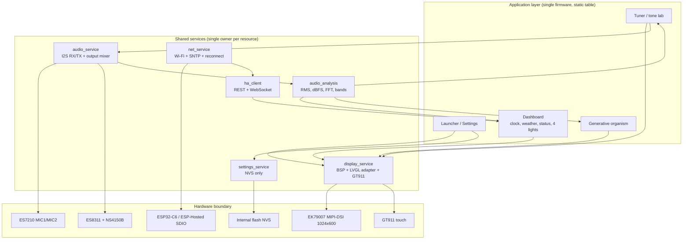

# Architecture

Target architecture for the product, plus the portability boundary. The current
firmware is the M5 launcher shell in `main/`; the service/app split below is the
M6–M11 destination, not yet implemented.

## Principles

- **One firmware, static app table, no dynamic loading.** Launcher, Dashboard,
  Organism, Tuner and Settings are linked into the image. Switching unmounts one
  LVGL tree and mounts another; no reflash or reboot.
- **Hardware owned once.** Display/touch/LVGL, I2S/codecs, Wi-Fi/netif and NVS
  each have a single service owner. Apps never call hardware init directly.
- **Audio is a shared service.** One I2S owner for capture and playback, one ring
  buffer, one analysis task, one output mixer, many readers of a feature
  snapshot.
- **Dashboard is a card grid.** Cards read services; tapping one opens a
  fullscreen detail view without leaving the dashboard app.
- **The organism engine is UI-agnostic.** It renders into an RGB565 buffer and
  does not include LVGL headers.
- **The tuner and tone engines are pure C.** Pitch detection and waveform
  synthesis build and run on the host; they never touch the codec directly.
- **No filesystem.** Large buffers in PSRAM; assets compiled into flash;
  settings in a tiny NVS namespace.
- **Bounded queues, timeouts, no blocking in UI.** Network never blocks
  rendering; audio never calls LVGL.

Decision: [ADR-0001](decisions/0001-single-firmware-static-apps.md).

## Target layout

> **Current implementation:** M5 launcher plus the M6 audio service:
> `main/services/audio_service.*` (capture + playback lanes + mixer),
> `main/services/audio_analysis.*`, and `main/engine/*` DSP/ring code. The
> dashboard still uses the bring-up probe internals; the Tuner app arrives at
> M9. Evidence: [`m6-audio-validation.md`](m6-audio-validation.md).

```text
battlestation-ui/
├── main/
│   ├── app_main.c
│   ├── app/
│   │   ├── app_manager.c/.h        # mount/unmount, lifecycle, app table
│   │   └── app_manifest.h          # static list of apps
│   ├── services/
│   │   ├── display_service.c/.h    # BSP display/touch/LVGL lock, brightness
│   │   ├── audio_service.c/.h      # I2S RX/TX, codec owner, ring + output mixer
│   │   ├── audio_analysis.c/.h     # RMS/dBFS/FFT/bands
│   │   ├── net_service.c/.h        # Wi-Fi, reconnect, SNTP/time
│   │   ├── ha_client.c/.h          # HA REST + WebSocket
│   │   └── settings_service.c/.h   # NVS: SSID, brightness, gain, HA token
│   ├── apps/
│   │   ├── launcher/
│   │   ├── dashboard/              # card grid + detail views
│   │   ├── organism/
│   │   ├── tuner/                  # tuner, tone generator, metronome
│   │   └── settings/
│   ├── engine/
│   │   ├── organism_engine.c/.h    # no LVGL; render to uint16_t*
│   │   ├── particle_system.c/.h
│   │   ├── vector_field.c/.h
│   │   ├── tuner_pitch.c/.h        # YIN/autocorrelation, pure C
│   │   ├── tone_gen.c/.h           # sine/square/triangle/saw, pure C
│   │   └── metronome.c/.h          # BPM/beat scheduling, pure C
│   ├── ui/
│   │   ├── theme.c/.h
│   │   └── widgets/                # light_card, level_graph, wave_graph, ...
│   └── protocol/
│       ├── ha_json.c/.h
│       └── weather_json.c/.h
└── docs/
```

## System diagram



## Audio data flow

```text
ES7210 MIC1/MIC2
      │ I2S RX (16 kHz, stereo, 16-bit)
      ▼
audio_service RX task ──► ring buffer (SPSC, ~200 ms)
      │                        │
      │                        ▼
      │                 audio_analysis task
      │                 - per-channel RMS
      │                 - dBFS, peak, Leq window
      │                 - Hann-windowed 1024-point FFT
      │                 - 16 half-octave band powers
      │                        │
      │                        ▼
      │                 feature snapshot (seqlock/double buffer)
      │                        │
      └──────────────► Dashboard / Organism / Tuner UI

tone_gen ─┐
metronome ─┴─► output mixer ──► audio_service TX task ──► ES8311 + NS4150B
```

Rules:

- Only `audio_service` calls `esp_codec_dev_read` / `esp_codec_dev_write`.
- Analysis never blocks the reader; the UI reads the latest snapshot and drops
  intermediate frames.
- The snapshot contains scalars/small arrays (e.g. 16 bands), not raw PCM.
- Apps that need raw PCM subscribe with a bounded copy; the default apps only
  need features.
- The tone generator and metronome submit PCM to the output mixer; they never
  touch the codec or I2S directly.
- Keep the RX and TX deadlines independent: analysis and synthesis must not run
  inside the I2S read/write tasks.

## Dashboard composition

The dashboard is a card grid; tapping a card opens a fullscreen detail view and
back returns to the grid (ADR-0012).

| Card | Source | Compact view | Detail view |
| --- | --- | --- | --- |
| Clock | `net_service` (SNTP) | Time + date | Large clock, timezone |
| Weather | `ha_client` weather entity | Temp + condition | Forecast, humidity/wind |
| Status | `net_service` + `audio_analysis` | Wi-Fi RSSI/IP, dB meter | Graphs, heap/temp |
| Light 0–3 | `ha_client` | On/off + brightness | Brightness/color temp, state |

- Cards are registered statically; each is a reusable LVGL widget.
- HA commands use an optimistic pending state until `state_changed` confirms.
- Weather prefers an HA entity; an external provider can be added behind the same
  card API later.
- Entity IDs and HA credentials start in Kconfig; runtime provisioning lands in
  M10.

## Audio output and the tone lab

The tuner/tone lab (M9) has three tools sharing one output path (ADR-0013):

- **Tuner** — YIN/autocorrelation with parabolic interpolation on the capture
  stream; note, cents, reference A4. Do not use the 16 kHz FFT bins for tuning.
- **Tone generator** — sine/square/triangle/saw, frequency, amplitude, optional
  sweep; click-free ramps.
- **Metronome** — BPM, time signature, accent, visual beat and click.
- **Graphs** — time-domain waveform, spectrum and cents needle at ≥ 30 fps.

The tuner/tone engines are pure C under `engine/`; they build on macOS and do
not include LVGL or codec headers. The output mixer needs an explicit priority
rule so the metronome and tone generator cannot clip or fight over the speaker.

## Tasks

| Task | Core | Priority | Stack | Responsibility |
| --- | ---: | ---: | ---: | --- |
| `audio_rx` | 0 | 12 | 4 KB | Block on I2S/codec read, push 10 ms frames |
| `audio_tx` | 0 | 11 | 4 KB | Output mixer → codec write, preallocated buffers |
| `audio_analysis` | 0 | 8 | 6 KB | RMS/dBFS/FFT, publish snapshot at 30–60 Hz |
| `lvgl` (adapter) | 1 | 6 | 8 KB | LVGL timer/render/flush, UI timers |
| `app_logic` | 1 | 5 | 6 KB | Active app state, input events, switching |
| `tone` | 1 | 5 | 6 KB | Synthesize tone/metronome into the output queue |
| `organism` | 1 | 4 | 8 KB | Render into back canvas, yield every frame |
| `net` | 0 | 3 | 8 KB | Wi-Fi events, HA REST/WS, reconnect |
| `services` | 0 | 4 | 4 KB | Settings, brightness, housekeeping |

Priorities are a starting point; measure with `vTaskGetRunTimeStats` and
`uxTaskGetStackHighWaterMark`. `audio_rx`/`audio_tx` preempt everything and must
have tiny critical sections. `net` must never block UI. Enable TWDT only for
tasks that can guarantee progress; the audio tasks block on I2S and must be
excluded or feed the watchdog deliberately.

## Ownership and synchronization

| Resource | Owner | Access rule |
| --- | --- | --- |
| LCD/panel/backlight | `display_service` | Only UI/LVGL task touches LVGL; brightness via service API |
| GT911 | `display_service` / adapter | LVGL input callback; apps receive semantic events |
| I2S + ES7210/ES8311 | `audio_service` | Single open/close; apps use snapshots or bounded copies |
| Playback mixer | `audio_service` | Tone/metronome submit buffers; never call the codec |
| Ring buffer | `audio_service` | One producer, one consumer; no dynamic allocation |
| Feature snapshot | `audio_analysis` | Seqlock or double buffer; readers never block producer |
| Tone/metronome engines | tuner app (pure C) | Synthesize into buffers; submit via `audio_service` |
| Tuner pitch detection | tuner app / `engine/` | Reads capture data; no codec access |
| Dashboard cards | dashboard app | Read services; detail views are internal state |
| Wi-Fi/netif | `net_service` | One event loop; app commands via queue |
| HA connection | `ha_client` | One WebSocket + one HTTP client; JSON on its task |
| NVS | `settings_service` | Small key/value only |
| Canvas buffers | `organism` | Engine writes back buffer; UI reads front after swap |
| LVGL objects | active app | Created/destroyed under the display lock |

Memory rules:

- Buffers > 16 KB go to PSRAM:
  `heap_caps_malloc(size, MALLOC_CAP_SPIRAM | MALLOC_CAP_8BIT)`.
- Task stacks stay internal unless measured otherwise.
- No `malloc` in the audio/ISR path; preallocate ring buffer and FFT arrays.
- Every `xTaskCreate` gets a stack high-water check in the soak test.
- Prefer static app descriptors; no heap-allocated app objects.

## App lifecycle

```c
typedef struct {
    const char *id;
    const char *title;
    esp_err_t (*mount)(lv_obj_t *parent);
    void (*unmount)(void);
    void (*tick)(uint32_t dt_ms);
} app_desc_t;
```

- `app_manager` keeps a static table: `launcher`, `dashboard`, `organism`,
  `tuner`, `settings`.
- Dashboard detail views are internal to the dashboard app, not new app entries.
- `mount` creates the app's LVGL tree under a parent container; `unmount`
  deletes it.
- Shared services initialize once in `app_main`; apps never own hardware.
- The launcher is itself an app; “home” returns to it.
- Mount/unmount happens under the LVGL lock; split long teardown if it exceeds
  one frame.
- Background audio/network continue while an app is unmounted; the app re-reads
  the latest snapshot on mount.

## Home Assistant

- **Transport:** WebSocket API (`/api/websocket`) for `state_changed` push and
  `call_service`; REST (`/api/`) for the initial snapshot and fallback.
- **Auth:** long-lived access token in NVS; never hard-code it in git.
- **Entities:** compile-time table first; a settings UI can edit later.
- **Flow:** Wi-Fi up → WebSocket auth → `subscribe_events` → state model →
  UI commands enqueue `call_service`.
- **Reconnect:** exponential backoff 1→2→4→8→15 s; resubscribe; no UI blocking.
- **TLS:** LAN HTTP first; add `esp_tls` + CA cert before exposing outside a
  trusted LAN. Measure the ~30–60 KB heap cost.
- **MQTT:** optional; do not run WS and MQTT for the same entities initially.

## Settings and persistence

No filesystem. A small NVS namespace holds device settings only:

```text
wifi_ssid, wifi_pass, brightness, mic_gain, ha_url, ha_token,
timezone, a4_hz, light_entity_0..3, weather_entity
```

No history, logs, images or media. If zero persistence is required later,
provisioning must be redone every boot — a UX decision, not a technical one.

Decision: [ADR-0009](decisions/0009-no-filesystem-or-ota.md).

## Portability boundary

The goal is to replace the board without rewriting the application, audio
analysis or organism engine.

| Layer | Board-specific? | Portability rule |
| --- | --- | --- |
| BSP / pins / panel timing | **Yes** | Confined to `display_service` and board config |
| Touch driver | **Yes** | Adapter/input callback behind `display_service` |
| Codec + I2S wiring | **Yes** | Confined to `audio_service` |
| C6 / ESP-Hosted transport | **Yes** | Confined to `net_service` |
| Display/touch API | No | Stable service API; no BSP headers above it |
| Audio capture API | No | Stable service API; no codec headers above it |
| Audio playback API | No | Stable service API; tone lab submits buffers |
| Analysis (RMS/dBFS/FFT/bands) | No | Pure C, testable on host |
| Tuner pitch / tone synthesis | No | Pure C engines, testable on host |
| UI, apps, app manager | No | LVGL-only; no pin/BSP references |
| Dashboard cards | No | LVGL-only; read services, no hardware |
| Organism engine | No | Pure C, renders to RGB565; no LVGL |
| HA client / JSON | No | Transport-agnostic beyond `net_service` |

Rules:

1. No `bsp_*` or `esp_lcd_*` includes in `apps/` or `engine/`.
2. No LVGL includes in `engine/`.
3. Hardware handles are opaque to apps; services expose semantic APIs.
4. Board-specific values live in one `board_config.h`/Kconfig surface, not
   scattered through the tree.
5. The organism, tuner and tone engines must build and run on macOS with stub
   buffers — this is the portability canary.

A future board port should only require: a new BSP, a new `display_service`
backend, a new `audio_service` backend, and a new `net_service` backend. If it
requires touching `apps/`, `engine/` or the analysis code, the boundary has
leaked.

Decision: [ADR-0007](decisions/0007-portability-boundary.md),
[ADR-0012](decisions/0012-dashboard-cards.md),
[ADR-0013](decisions/0013-audio-output-tuner.md).
