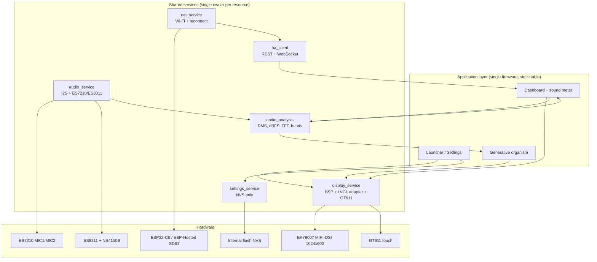

# ESP32-P4-WIFI6-Touch-LCD-7B — Research & Development Handoff

**Board:** Waveshare ESP32-P4-WIFI6-Touch-LCD-7B (SKU 32510; camera variant 32511 = 7B-C)\
**Host:** macOS 26.7.1, Apple Silicon (arm64)\
**Prepared:** 2026-11-06\
**Status:** Research complete; official examples and the first integrated probe compile; hardware runtime validation is the next step.

### Evidence legend

| Tag | Meaning |
| --- | --- |
| **Verified** | Read directly from the official schematic, BSP source, official repository, Espressif documentation, or confirmed by a successful build on this machine. |
| **Assumption** | Consistent with the evidence but not yet exercised on this specific board. |
| **Open** | Must be measured or tested on the physical unit before relying on it. |

---

## 0. Executive summary

The reliable path for this board is **native ESP-IDF v5.5.5 + the official Waveshare BSP 3.0.1 + LVGL 9.5.0 + `esp_lvgl_adapter` 0.6.x + `esp_codec_dev`**, with a thin application/service layer that owns the hardware once and lets the launcher, dashboard and generative app share it.

Do **not** start from a generic ESP32-P4 example, Arduino, PlatformIO, or a random LVGL port. This board's display, touch, audio routing and C6 transport are all encoded in the Waveshare BSP, and the BSP is pinned to specific LVGL/IDF versions.

Three facts drive the whole plan:

1. **The display is an EK79007 MIPI-DSI panel at 1024×600, not an SPI/RGB panel.** It is driven through the BSP with 2 DSI lanes, 52 MHz pixel clock, and 3 DPI framebuffers by default.
2. **The two onboard microphones are ES7210 MIC1/MIC2.** The ES7210 also has MIC3/MIC4 connected to the speaker/echo-reference network, so “4-channel ADC” does not mean four microphones. The default `esp_codec_dev` configuration selects MIC1|MIC2, giving stereo capture.
3. **The ESP32-P4 has no radio.** Wi-Fi 6 and BLE come from an ESP32-C6 over SDIO using ESP-Hosted. Host and C6 firmware versions must match; the factory C6 image may be older or newer than the host stack you choose. Validate before reflashing the C6.

The current firmware milestone (`battlestation-ui/`) proves display, GT911 touch, LVGL, ES7210 stereo capture with dBFS, and hosted Wi-Fi in **one image**. It builds at **1,066,112 bytes (1.02 MiB)** with **87% of an 8 MB app slot free**.

**First action:** connect the board through the USB-C **“USB TO UART”** port, run `ls /dev/cu.*`, then `esptool.py --chip esp32p4 -p <PORT> chip_id` and read the P4 silicon revision before flashing anything. Rev1.x and Rev3.x images are not boot-compatible.

---

## A. Hardware compatibility report

### A.1 Verified board architecture

| Subsystem | Verified value | Evidence |
| --- | --- | --- |
| Board | ESP32-P4-WIFI6-Touch-LCD-7B, 7-inch 1024×600 touch display dev board | Waveshare product page and official repo |
| Main SoC | ESP32-P4NRW32X, dual-core HP RISC-V up to 360 MHz + LP RISC-V core | Waveshare docs, BSP, repo README |
| PSRAM | 32 MB in-package PSRAM | Waveshare docs, repo README, 32 MB sdkconfig |
| Flash | 32 MB external NOR flash on the ESP32-P4-Core module | Waveshare docs/schematic; `CONFIG_ESPTOOLPY_FLASHSIZE_32MB` in examples |
| Wireless | ESP32-C6-MINI-1-N4 (4 MB flash), SDIO to P4; Wi-Fi 6 2.4 GHz + BLE 5 | Schematic, BSP repo, Waveshare docs |
| Display | 7-inch IPS, 1024×600, MIPI-DSI, EK79007 controller | Waveshare FAQ + BSP source |
| Display link | 2 DSI data lanes, 1000 Mbit/s per lane, 52 MHz pixel clock, 60 Hz panel config | `bsp/display.h` in BSP 3.0.1 |
| Touch | GT911 capacitive, 5-point capable, I2C, address 0x5D or 0x14 | BSP `bsp_touch_new()` + FAQ |
| Touch INT/RST | Not connected (`GPIO_NUM_NC`); polling mode | BSP header + Arduino README |
| Audio ADC | ES7210, 4-channel ADC, I2C 7-bit 0x40 (driver constant 0x80 = 8-bit form) | Schematic + `esp_codec_dev` source |
| Audio DAC | ES8311, I2C 7-bit 0x18, speaker path via NS4150B class-D amplifier | Schematic + BSP source |
| Microphones | Two onboard analog mics on ES7210 MIC1/MIC2; MIC3/MIC4 are the speaker/AEC reference network | Schematic nets `MIC1_P/N`, `MIC2_P/N`, `ADC_MIC3/4` labeled `AEC ADC` |
| Speaker | PH2.0 header, NS4150B, enable on GPIO53 | BSP header `BSP_POWER_AMP_IO` |
| microSD | SDIO 3.0, slot 0, GPIO39–44 | BSP header (not required for this project) |
| USB-C UART | CH343P USB-UART bridge on UART0 GPIO37/38, DTR/RTS auto-download | Schematic (U6 CH343P, U7 transistor network) |
| USB-C native | ESP32-P4 USB 2.0 Full-Speed OTG PHY, wired as USB Serial/JTAG on `USB1P1_N/P` (GPIO24/25 default); board labels it “USB1.1 FS” | Schematic + P4 datasheet |
| USB-A | USB 2.0 OTG High-Speed **host** port | Schematic + Waveshare hardware description |
| C6 UART | Header/pads `C6_U0RXD`, `C6_U0TXD`, `C6_IO9`, `C6_CHIP_PU`; not a USB port | Schematic + FAQ |
| Expansion | CAN/TWAI, RS485, I2C, UART, GPIO headers | Waveshare docs/schematic |
| Power | 5 V via either USB-C; onboard power switch; optional RTC battery | Waveshare docs |

### A.2 Verified pin map (BSP 3.0.1 + schematic)

| Function | P4 pin | Notes |
| --- | --- | --- |
| I2C SCL | GPIO8 | Shared by GT911, ES8311, ES7210 |
| I2C SDA | GPIO7 | Shared |
| I2S MCLK | GPIO13 | To ES8311/ES7210 |
| I2S SCLK/BCLK | GPIO12 | Shared bit clock |
| I2S LRCK/WS | GPIO10 | Shared word clock |
| I2S DOUT (P4 → codec) | GPIO9 | ES8311 DAC data |
| I2S DIN (codec → P4) | GPIO11 | ES7210 ADC data |
| Speaker PA enable | GPIO53 | NS4150B, active high |
| LCD backlight | GPIO32 | LEDC PWM, output inverted in BSP |
| LCD reset | GPIO33 | Shared panel reset |
| LCD touch reset | NC | GT911 reset not wired |
| LCD touch interrupt | NC | Polling only |
| microSD CLK/CMD/D0–D3 | GPIO43/44/39/40/41/42 | Not used |
| UART0 TX/RX | GPIO37/38 | CH343P |
| C6 SDIO (P4 side) | GPIO14–17 = D0–D3, GPIO18 = CLK, GPIO19 = CMD | Confirmed by the resolved `esp_hosted` Kconfig in example 05 (4-bit, 40 MHz) |
| C6 reset | GPIO54 → `C6_CHIP_PU` (0 Ω link) | Schematic + resolved `CONFIG_ESP_HOSTED_GPIO_SLAVE_RESET_SLAVE=54` |
| Native USB | `USB1P1_N/P` (GPIO24/25 default) | USB Serial/JTAG; USB 2.0 Full-Speed PHY |

> **Do not infer pins from a generic ESP32-P4 board.** The 7B uses a specific EK79007 panel, GT911 wiring, ES7210/ES8311 arrangement and C6 SDIO wiring. The BSP is the authoritative pin source.

### A.3 Display details

- **Controller:** EK79007, MIPI-DSI, 1024×600.
- **BSP geometry:** `BSP_LCD_H_RES=1024`, `BSP_LCD_V_RES=600`.
- **DSI:** 2 data lanes, 1000 Mbit/s per lane; PHY LDO channel 3 at 2.5 V.
- **DPI timing:** HSYNC 1344, HBP 160, HFP 160; VSYNC 635, VBP 23, VFP 12; 52 MHz pixel clock.
- **Color:** RGB565 default; RGB888 optional via `CONFIG_BSP_LCD_COLOR_FORMAT_RGB888`. For this project, stay RGB565: 1.23 MB/frame instead of 1.84 MB, and half the bandwidth.
- **Tearing:** The BSP default and the official examples use `ESP_LV_ADAPTER_TEAR_AVOID_MODE_TRIPLE_PARTIAL` with `CONFIG_BSP_LCD_DPI_BUFFER_NUMS=3`.
- **Backlight:** LEDC channel 1, 5 kHz, 10-bit; `bsp_display_brightness_set(0…100)`.
- **Touch orientation (measured on this unit):** the factory/BSP display orientation is **180°**, but the correct GT911 mapping at 180° on this unit is **`swap_xy=0, mirror_x=0, mirror_y=0`**. The official `09`/factory combination of 180° + `mirror_x=1, mirror_y=1` maps the visual top-left to **(1023,599)** — a 180° touch error. At display rotation 0°, `mirror_x=1, mirror_y=1` is correct (verified with `08_lvgl_display_panel`). The milestone makes the flags rotation-dependent. This is an important board/panel-batch quirk; do not blindly copy the BSP’s `bsp_display_start()` touch flags.
- **Five-point capability vs LVGL default:** The GT911 and `CONFIG_ESP_LCD_TOUCH_MAX_POINTS=5` support five points, but `ESP_LV_ADAPTER_TOUCH_DEFAULT_CONFIG` registers a **single pointer** (`multi_touch.mode = SINGLE`, `pointers = 1`). For five independent LVGL pointers, set `mode = ESP_LV_ADAPTER_TOUCH_MODE_MULTI_CONTROL` and `pointers = 5` (or the number you need). The bring-up intentionally keeps single-pointer semantics.

### A.4 Audio details

- **ES7210** is a 4-channel ADC, but this board uses:
  - MIC1/MIC2: the two onboard microphones (differential inputs).
  - MIC3/MIC4: fed from the speaker output network, labeled `AEC ADC` in the schematic, for echo cancellation/reference. They are not additional microphones.
- **Default software selection:** `esp_codec_dev`’s ES7210 driver defaults to `MIC1 | MIC2` when `mic_selected == 0`, so `bsp_audio_codec_microphone_init()` gives 2-channel capture. It sets 30 dB by default; the official audio example sets 24 dB.
- **ES8311** is the speaker DAC; the NS4150B amplifier is enabled by GPIO53.
- **Shared I2S:** Both codecs share one I2S peripheral in duplex mode. If you open speaker and microphone with different sample rates/channel counts, `esp_codec_dev` rejects the conflict. The audio service must own one format (recommended: 16 kHz, 16-bit, stereo).
- **Supported rates:** ES7210 supports 8–100/96 kHz and 24-bit; ES8311 driver tables cover 8–96 kHz. The BSP default is 22.05 kHz mono; the official example uses 16 kHz stereo 16-bit. 16 kHz is enough for sound-level and voice work; 48 kHz if you need a wider spectrum.
- **Calibration:** The board has no acoustic calibrator and no per-unit microphone sensitivity data in the repo. dBFS is a digital level, not dB SPL. See §B.6 and §F.4.

### A.5 Wireless details

- The P4 has **no integrated Wi-Fi/BT**. The C6 is a slave co-processor over **SDIO**.
- The host runs the TCP/IP stack (`esp_netif`/lwIP); the C6 runs the Wi-Fi/BT radio stack. `esp_wifi_remote` exposes the normal `esp_wifi_*` API; `esp_hosted` implements the SDIO/RPC transport.
- The official Wi-Fi example pins `espressif/esp_hosted 1.4.*` and `espressif/esp_wifi_remote ==1.2.5`. This is the conservative match to the factory C6 image.
- The resolved example configuration confirms the P4-side SDIO wiring: `CLK=18`, `CMD=19`, `D0=14`, `D1=15`, `D2=16`, `D3=17`, slave reset `54`, 4-bit bus, 40 MHz. This matches the schematic and removes the need to guess C6 pins.
- **C6 firmware is a separate firmware image.** The board ships with ESP-Hosted slave firmware. Do not reflash it just because the host stack has a newer version. First capture the host boot log and verify the transport handshake.
- The C6 supports 2.4 GHz Wi-Fi 6 and BLE 5. BLE is possible through ESP-Hosted, but it needs the host Bluetooth stack and is not required for Apps A/B/C. Treat BLE as a separate validation item.

**Host init sequence (the path the official example uses):**

```text
nvs_flash_init
  → esp_netif_init
  → esp_event_loop_create_default
  → esp_netif_create_default_wifi_sta
  → esp_wifi_init
       └─ esp_wifi_remote → esp_hosted init → SDIO 4-bit @ 40 MHz → C6 reset (GPIO54)
  → esp_wifi_set_mode(STA)
  → esp_wifi_set_config(SSID/password)
  → esp_wifi_start
       └─ WIFI_EVENT_STA_START → esp_wifi_connect
  → IP_EVENT_STA_GOT_IP
```

If `esp_wifi_init` fails, the most likely causes are C6 firmware/host protocol mismatch, C6 not booted, or SDIO wiring/power. Capture the host log before touching the C6.

### A.6 USB / flashing wiring (answers the “three USB ports” question)

| Port | What it is | Can flash P4? | Use |
| --- | --- | --- | --- |
| **USB-C “USB TO UART”** | CH343P bridge → UART0 GPIO37/38, with DTR/RTS auto-reset | **Yes** | Primary flashing + serial monitor. Recommended first. |
| **USB-C “USB1.1” / native USB** | ESP32-P4 USB 2.0 Full-Speed OTG PHY, wired as USB Serial/JTAG (GPIO24/25 default); board labels it “USB1.1 FS” | **Yes** | Driverless flashing/monitor; good fallback if the CH343 driver misbehaves. |
| **USB-A “USB OTG”** | USB 2.0 OTG HS **host** | **No** | Keyboard, mouse, USB storage, etc. It is a host port, not a device port to the Mac. |
| **C6 UART header** | C6 U0TXD/U0RXD + IO9 + CHIP_PU | C6 only | Only for deliberate C6 firmware recovery/update; needs a 3.3 V USB-UART adapter and manual IO9/EN sequence. Not needed for normal P4 flashing. |

**macOS port names:**

- CH343P can appear as `/dev/cu.usbmodem*` with Apple’s built-in CDC driver, or `/dev/cu.wchusbserial*` with WCH’s CH34x driver 2.1.
- Native P4 USB Serial/JTAG appears as `/dev/cu.usbmodem*` (different suffix), no driver needed. The milestone config resolved with both UART0 and USB Serial/JTAG secondary console enabled, so either port can show logs.
- Always use `/dev/cu.*`, not `/dev/tty.*` (the latter waits for carrier detect).
- If the built-in CH343 CDC port monitors but fails to flash with `Failed to write to target RAM`, install WCH’s driver or use the native USB-C port.

### A.7 Revision traps

There are two independent revision axes:

1. **ESP32-P4 silicon revision (v1.x vs v3.x).** Waveshare’s repo default is Rev3.x (`CONFIG_ESP32P4_REV_MIN_300=y`), but this unit is confirmed **v1.3**. Rev1.x and Rev3.x images are **not boot-compatible**; the bootloader rejects the wrong range. Use `config/esp32p4_rev1_3.defaults` / our `sdkconfig.rev1_3.defaults`. The v1.3 image booted and ran `00_board_check` and `08_lvgl_display_panel` successfully.
2. **PCB/board revision.** The BSP README says “HW V1.0 → BSP ^1”, but the current BSP is 3.0.1; BSP version numbers are not PCB revisions. Inspect the silkscreen; if the board is a 7B (not 7B-C camera variant), BSP 3.0.1 is the current official match. The camera variant adds an OV5647; it does not change display/touch/audio pins.

### A.8 Documentation inconsistencies found

| Claim in docs | What the code/schematic shows | Decision |
| --- | --- | --- |
| “ESP-IDF V5.3.1 or later” (ESP-IDF page) | BSP requires `idf >=5.5`; `esp_lvgl_adapter` requires >=5.5.5; repo CI validates v5.5.5 and v6.0.2 | Use **v5.5.5**. |
| “v5.5.1–v5.5.4 recommended” (FAQ) | v5.5.5 is the current patch and is CI-validated | Use **v5.5.5**. |
| `09_lvgl_demo_v9` README says LVGL 9.2.x | Manifest pins `lvgl/lvgl ==9.5.0`; BSP requires `~9.5.0` | Use **9.5.0**, ignore the stale README sentence. |
| `00_board_check` README expects “Flash size: 16 MB” | Hardware/docs/config say 32 MB | Trust `esptool flash_id` / runtime `esp_flash_get_size`; README text is stale. |
| BSP README “HW version V1.0 → BSP ^1” | Current BSP 3.0.1 is the 7B BSP | Treat 3.0.1 as current; PCB revision is separate. |
| BSP README dependency table says `esp_codec_dev 1.2.*` | Actual BSP 3.0.1 resolves `esp_codec_dev 1.5.11` | Trust the manifest, not the generated table. |

---

## B. Recommended software stack

### B.1 Versions (verified by build on 2026-11-06)

| Component | Version | Why |
| --- | --- | --- |
| **ESP-IDF** | **v5.5.5** | BSP requires >=5.5; adapter requires >=5.5.5; Waveshare CI builds all examples with 5.5.5 and 6.0.2. 5.5.5 is the lower-risk choice. |
| **Board BSP** | `waveshare/esp32_p4_wifi6_touch_lcd_7b` **3.0.1** | Official board support: EK79007, GT911, ES8311/ES7210, SD, USB, LVGL adapter. |
| **LVGL** | **9.5.0** (exact) | BSP depends on `~9.5.0`; examples pin `==9.5.0`. Do not use 9.2.x or 8.4 with this BSP. |
| **LVGL adapter** | `espressif/esp_lvgl_adapter` **0.7.5** (local override; BSP 3.0.1 would otherwise resolve 0.6.4) | Unified display/touch/tearing/locking; 0.6.4 has a known DSI framebuffer deadlock, fixed in 0.7.3. Do not add legacy `esp_lvgl_port`. |
| **LCD driver** | `espressif/esp_lcd_ek79007` **2.0.2~1** | EK79007 MIPI-DSI panel driver, brought in by the BSP. |
| **Touch driver** | `espressif/esp_lcd_touch_gt911` **1.2.1** | GT911 driver, brought in by the BSP. |
| **Audio codec** | `espressif/esp_codec_dev` **1.5.11** (BSP `~1.5`) | ES8311/ES7210 drivers, I2S data interface, volume/gain. |
| **Wi-Fi transport** | `espressif/esp_hosted` **1.4.7**, `espressif/esp_wifi_remote` **1.2.5** | Matches the Waveshare Wi-Fi example pin; conservative for the factory C6. |
| **DSP** | `espressif/esp-dsp` **1.8.2** | Official DSP library; README explicitly lists ESP32-P4 support. Use for 1024-point FFT/windows. |
| **WebSocket** | `espressif/esp_websocket_client` **1.8.0** | Home Assistant WebSocket API. |
| **JSON / MQTT** | `cJSON` (IDF built-in), `esp-mqtt` (IDF built-in, optional) | HA REST/WS parsing; MQTT only if a broker exists. |
| **UI editor** | EEZ Studio 0.29+ (optional) | Good for static screens, generates LVGL 9 C; keep dynamic screens hand-written. |

### B.2 Why not alternatives

- **Arduino:** Waveshare explicitly says ESP32-P4 Arduino adaptation is limited and recommends ESP-IDF. The Arduino examples exist, but the native BSP/IDF path exposes PSRAM, DSI, I2S DMA and task control more directly.
- **PlatformIO:** Community P4 support lags the IDF version this BSP requires. It adds another version-resolution layer for no benefit.
- **ESP-Brookesia:** A full app framework (services, JSON UI, runtimes, app store, persistence) aimed at productized HMI. The factory firmware uses an old 0.4.x line. For three tightly coupled real-time apps, it is overkill and would obscure hardware ownership. Use it only as a reference for launcher ideas.
- **LVGL 8.4 / 9.2:** Used by some community 7B projects, but BSP 3.0.1 expects 9.5 APIs. Mixing versions will break the adapter.
- **Generic `esp_lvgl_port`:** The BSP uses `esp_lvgl_adapter`; adding the legacy port beside it causes duplicate display/input management.
- **Direct register programming:** No benefit; the BSP already exposes the needed handles and the panel is a standard EK79007.

### B.3 PPA acceleration policy

The BSP sets `enable_ppa_accel = false`. The adapter can offload LVGL RGB565/RGB888 blend/fill to the P4 PPA, but:

- LVGL v9 PPA drawing requires `LV_DRAW_SW_DRAW_UNIT_CNT == 1` (the BSP examples set 2).
- The adapter ships a known PPA hang workaround patch for P4 (`0001-bugfix-ppa-Temporary-fix-for-the-PPA-hang-issue.patch`), especially with triple-partial + rotation.
- Enable PPA only after a baseline benchmark and only with that patch applied/validated.

**Decision:** keep PPA off for the milestone and the first UI. Revisit if blending is the measured bottleneck.

### B.4 Graphics approach comparison

| Approach | Strengths | Weaknesses | Verdict |
| --- | --- | --- | --- |
| **LVGL 9.5 + BSP adapter** | Mature widgets, touch/input, animations, BSP integration, active upstream | Software rendering; complex full-screen scenes can be CPU-bound | **Use for launcher, dashboard, settings** |
| **Custom esp_lcd + PPA/canvas** | Direct control, no widget overhead, ideal for full-screen generative art; can use PPA scale/rotate | You build text/input/layout yourself; PPA has errata/patch caveats | **Use inside the organism**, rendered to an RGB565 buffer |
| **ESP-Brookesia GUI** | JSON UI, app lifecycle, services | Heavy framework, persistence/app-store assumptions, old factory line | Reference only |
| **Arduino GFX / LovyanGFX** | Simple for small SPI displays | P4 DSI/LVGL 9 support immature; loses IDF task/memory control | Avoid |
| **Qt/Flutter/HTML UI** | Rich tooling | No viable P4 GPU/runtime; memory and latency | Not viable on this board |

The hybrid approach is deliberate: LVGL for interactive UI, a custom engine for the organism, one shared display pipeline.

### B.5 Recommended initial audio configuration

| Parameter | Recommendation | Why |
| --- | --- | --- |
| Sample rate | **16 kHz** | Covers sound-level and voice bands; low CPU/memory; 48 kHz optional later for wider spectrum |
| Bit depth | **16-bit** | 96 dB theoretical; matches ES7210/ES8311 example; 24/32-bit optional for low-level ambient work |
| Channels | **2 (MIC1/MIC2)** | Two physical mics; keep per-channel RMS; no AEC reference by default |
| PGA gain | **24 dB** start | Official example default; 30 dB driver default is hotter; keep fixed while comparing dBFS |
| I2S DMA | 6 descriptors × ~240 frames | ~6 KB; enough to absorb scheduling jitter |
| Ring buffer | 200 ms | 12.8 KB at 16 kHz stereo 16-bit; decouples analysis from DMA |
| Analysis frame | 1024 samples, Hann, 50% overlap | 64 ms window, 15.6 Hz bins; update every 32 ms |
| Metrics | RMS, dBFS, peak, Leq window, 16 bands | Enough for meter + organism; no false SPL claim |

---

## C. Repository analysis

Maintenance data from GitHub API / component registry on **2026-11-06**. Stars are a weak signal; maintenance and exact-board evidence matter more.

### C.1 Official Waveshare / Espressif

| Repository | What it is | P4? | Exact 7B? | Last activity | Use |
| --- | --- | --- | --- | --- | --- |
| [waveshareteam/ESP32-P4-WIFI6-Touch-LCD-7B](https://github.com/waveshareteam/ESP32-P4-WIFI6-Touch-LCD-7B) | 18 ESP-IDF examples, Arduino examples, docs, BSP CI, Brookesia factory source, prebuilt factory BIN | Yes | **Yes** | 2026-08-21; 47★; Apache-2.0 | **Primary reference.** Build examples from here; do not vendor the whole repo into the product. |
| [Waveshare-ESP32-components](https://github.com/waveshareteam/Waveshare-ESP32-components) | Source of `waveshare/esp32_p4_wifi6_touch_lcd_7b` BSP | Yes | Yes | 2026-10-12; 82★; Apache-2.0 | **Dependency via registry**; inspect source for pins/debug. |
| [esp-idf](https://github.com/espressif/esp-idf) v5.5.5 | Framework | Yes | N/A | 2026-11-05; 19.4k★; Apache-2.0 | **Use.** |
| [lvgl/lvgl](https://github.com/lvgl/lvgl) 9.5 | Graphics library | Yes | N/A | 2026-11-05; 25.1k★; MIT | **Use**, pinned. |
| [esp_lvgl_adapter](https://components.espressif.com/components/espressif/esp_lvgl_adapter) | Official LVGL adapter for ESP-IDF | Yes | Via BSP | Registry 0.7.5 latest; BSP resolves 0.6.4 | **Use 0.7.5 via local override.** 0.6.4 has a known DSI framebuffer deadlock (issue #793); BSP 3.0.1 still compiles with 0.7.5. |
| [esp-hosted-mcu](https://github.com/espressif/esp-hosted-mcu) | ESP-Hosted RPC co-processor transport | Yes | Via C6 | 2026-11-05; 195★; source-available | **Use pinned 1.4.x for factory C6**; newer 2.x/3.x requires a coordinated C6 update. |
| [esp-brookesia](https://github.com/espressif/esp-brookesia) | Full HMI/AIoT app framework | Yes | Factory firmware uses it | 2026-10-29; 832★; Apache-2.0 | **Reference only.** Overkill for this custom 3-app firmware; v0.4 used by factory is old. |
| [esp_codec_dev](https://components.espressif.com/components/espressif/esp_codec_dev) | ES8311/ES7210 codec drivers | Yes | Via BSP | Registry 1.6.2 latest; BSP resolves 1.5.11 | **Use via BSP.** |
| [esp-dsp](https://github.com/espressif/esp-dsp) | Optimized DSP/FFT | Yes | N/A | 2026-05-11; 722★; Apache-2.0 | **Use** for FFT/windows; add explicitly. |
| [esp_websocket_client](https://components.espressif.com/components/espressif/esp_websocket_client) | WebSocket client | Yes | N/A | Registry 1.8.0 | **Use** for HA push updates. |
| [esp_lcd_ek79007](https://components.espressif.com/components/espressif/esp_lcd_ek79007) | EK79007 driver | Yes | Yes | Registry 2.0.2~1 | **Use via BSP.** |
| [esp_lcd_touch_gt911](https://components.espressif.com/components/espressif/esp_lcd_touch_gt911) | GT911 driver | Yes | Yes | Registry 1.2.1 | **Use via BSP.** |

### C.1.1 Official example map (paths verified in the repo)

| Example | What it proves | Built here? |
| --- | --- | --- |
| `examples/esp-idf/00_board_check` | Target, chip revision, 32 MB flash, PSRAM, heap | **Yes** |
| `examples/esp-idf/03_i2c_tools` | I2C scan on SDA=7/SCL=8; expect ES8311 0x18, ES7210 0x40, GT911 0x5D/0x14 | **Yes** |
| `examples/esp-idf/05_wifistation` | C6 hosted Wi-Fi station, IP acquisition | **Yes** |
| `examples/esp-idf/06_i2s_codec` | ES8311 playback + ES7210 capture (music or echo) | **Yes** |
| `examples/esp-idf/07_color_panel` | Raw EK79007 DSI bring-up / color bars, no LVGL | No (reference) |
| `examples/esp-idf/08_lvgl_display_panel` | LVGL 9.5 + GT911 touch, RGB screens, touch squares | **Yes** |
| `examples/esp-idf/09_lvgl_demo_v9` | LVGL 9.5 widgets demo | **Yes** |
| `examples/esp-idf/11_esp_brookesia_phone` | Brookesia phone UI on this board | No (reference; old framework) |
| `examples/esp-idf/12_usb_extend_screen` | USB host/device display path | No (not needed) |
| `examples/esp-idf/16_freertos_tasks` | FreeRTOS task/queue patterns | No (reference) |
| `examples/esp-idf/17_system_monitor` | Runtime diagnostics | No (reference) |
| `examples/esp-idf/18_mp4_player` | SD-card MP4/AVI playback | No (out of scope) |

All examples use **ESP-IDF**, not Arduino. The repo also carries Arduino 3.3.11 sketches, but Waveshare’s own documentation recommends ESP-IDF for P4 stability. The factory-style Brookesia firmware is a third surface and is not built by default example CI.

### C.2 Community projects targeting the exact 7B

| Repository | What it demonstrates | P4? | Exact 7B? | Last activity / license | Verdict |
| --- | --- | --- | --- | --- | --- |
| [kruzio1985/BETTA-HA-PANEL-7-Waveshare-7B](https://github.com/kruzio1985/BETTA-HA-PANEL-7-Waveshare-7B) | Working Home Assistant wall panel: WebSocket + REST fallback, LVGL UI, Wi-Fi provisioning, OTA, brightness, camera on 7B-C | Yes | **Yes** | 2026-10-17; 4★; **FNCL-1.1 source-available, non-commercial** | **Reference only, not a dependency.** Strong evidence that HA over WebSocket works on this board. Its 7B notes report v1.x silicon and use `REV_MIN_100`. |
| [trailcurrentoss/TrailCurrentFluidCNCPendant](https://github.com/trailcurrentoss/TrailCurrentFluidCNCPendant) | Touch pendant: Wi-Fi setup through C6, WebSocket/UART, EEZ Studio UI | Yes | **Yes** | 2026-10-02; 10★; **no license file** | **Reference only.** Uses LVGL 8.4 and is demo/safety-limited; useful for Wi-Fi provisioning and EEZ workflow, not for code reuse. |
| [trailcurrentoss/YouTubeCodeSamples — eez-studio-update-lvlg-9](https://github.com/trailcurrentoss/YouTubeCodeSamples/tree/main/eez-studio-update-lvlg-9) | Full EEZ Studio + LVGL 9.2.2 dashboard on the 7B, with simulator | Yes | **Yes** | 2026-10-30; 6★; MIT | **Reference.** Good UI layout/simulator example; LVGL 9.2 is older than BSP 3.0.1 requires, so port patterns, not the dependency. |
| [shafiq9018/WaveShare-ESP32-P4-WIFI6-Touch-LCD-7B-Enclosure](https://github.com/shafiq9018/WaveShare-ESP32-P4-WIFI6-Touch-LCD-7B-Enclosure) | OpenSCAD enclosure | N/A | Yes | Community | Mechanical reference only. |

### C.3 What is actually worth depending on

**Use as dependencies (managed components):**

- `waveshare/esp32_p4_wifi6_touch_lcd_7b == 3.0.1`
- `lvgl/lvgl == 9.5.0`
- `espressif/esp_lvgl_adapter ~0.6` (transitive)
- `espressif/esp_codec_dev ~1.5` (transitive)
- `espressif/esp_hosted 1.4.*` + `espressif/esp_wifi_remote ==1.2.5` (for now)
- `espressif/esp-dsp` (for FFT)
- `espressif/esp_websocket_client` (for HA)

**Use as reference only:**

- Waveshare examples (copy the bring-up patterns, not the whole projects)
- ESP-Brookesia (launcher ideas; not the framework)
- BETTA HA panel (HA protocol/UX; license restricts reuse)
- TrailCurrent FluidCNC / EEZ sample (Wi-Fi provisioning, EEZ workflow, layout ideas)
- Arduino examples (pin cross-check only)

**Avoid:**

- Abandoned LVGL 8.4 forks as the base for a new product.
- Generic P4 BSPs with 800×1280 or 10.1-inch defaults (the 7B is 1024×600).
- Mixing `esp_lvgl_port` with `esp_lvgl_adapter`.
- Upgrading `esp_hosted` without updating/validating the C6.

---

## D. Development environment setup (macOS Apple Silicon)

These commands were used on this machine and produced successful builds of examples 00, 05, 06, 08, 09 and `battlestation-ui`.

### D.1 Prerequisites

```bash
xcode-select --install          # if not already installed
brew install cmake ninja dfu-util ccache python@3.11
```

Notes:

- macOS 26.7.1 arm64 was used. Xcode command line tools were already present.
- ESP-IDF’s installer downloads the RISC-V toolchain and OpenOCD; it does not replace Xcode.
- Homebrew Python 3.14.7 worked, but ESP-IDF creates its own virtualenv. If your Python is managed by `uv`, `pyenv`, conda or a tool virtualenv, read D.3 carefully.

### D.2 Install ESP-IDF v5.5.5

```bash
mkdir -p "$HOME/esp"
cd "$HOME/esp"
git clone -b v5.5.5 --depth 1 --recursive \
  https://github.com/espressif/esp-idf.git esp-idf-v5.5.5
cd esp-idf-v5.5.5
./install.sh esp32p4
```

The recursive clone is ~2 GB and takes several minutes. If it is interrupted, re-run `git submodule update --init --recursive`.

### D.3 The `VIRTUAL_ENV` trap (important on this machine)

This Mac’s `python3` initially resolved to a `uv`-managed `spotdl` virtualenv. `install.sh` refused to create the IDF Python environment:

```text
ERROR: This script was called from a virtual environment, can not create a virtual environment again
```

The working sequence was:

```bash
unset VIRTUAL_ENV PYTHONHOME PYTHONPATH
export PATH="/opt/homebrew/bin:/usr/bin:/bin:/usr/sbin:/sbin"
export IDF_PYTHON_ENV_PATH="$HOME/.espressif/python_env/idf5.5_py3.14_env"
cd "$HOME/esp/esp-idf-v5.5.5"
./install.sh esp32p4
```

If the installer already created a 3.14 environment, reuse it; do not create a second one. The environment directory name depends on the Python version (`idf5.5_py3.14_env` here).

If a Python package fails to build on 3.14, install Homebrew `python@3.11`, put `/opt/homebrew/opt/python@3.11/bin` first in `PATH`, remove the incomplete `~/.espressif/python_env/idf5.5_py3.14_env`, and re-run `./install.sh esp32p4`. The IDF version does not change.

### D.4 Load the environment

```bash
unset VIRTUAL_ENV PYTHONHOME PYTHONPATH
export PATH="/opt/homebrew/bin:/usr/bin:/bin:/usr/sbin:/sbin"
export IDF_PYTHON_ENV_PATH="$HOME/.espressif/python_env/idf5.5_py3.14_env"
source "$HOME/esp/esp-idf-v5.5.5/export.sh"
idf.py --version
```

Expected:

```text
ESP-IDF v5.5.5
```

Add an alias to `~/.zshrc` if you like:

```bash
alias get_idf='unset VIRTUAL_ENV PYTHONHOME PYTHONPATH; \
  export PATH="/opt/homebrew/bin:/usr/bin:/bin:/usr/sbin:/sbin"; \
  export IDF_PYTHON_ENV_PATH="$HOME/.espressif/python_env/idf5.5_py3.14_env"; \
  source "$HOME/esp/esp-idf-v5.5.5/export.sh"'
```

### D.5 Clone the official board repository

```bash
mkdir -p "$HOME/REPOS/REPROPIOS/BATTLESTATION"
cd "$HOME/REPOS/REPROPIOS/BATTLESTATION"
git clone --depth 1 \
  https://github.com/waveshareteam/ESP32-P4-WIFI6-Touch-LCD-7B.git waveshare-board
```

The repository is ~229 MB. The useful ESP-IDF examples are under `examples/esp-idf/`.

### D.6 Build the official examples (serialize first builds)

**Do not run multiple first-time `idf.py` builds in parallel.** They share the Component Manager cache under `~/Library/Caches/Espressif/ComponentManager`; a race corrupted a cached component during this investigation. Build each new project once serially, then parallel builds are safe.

```bash
cd "$HOME/REPOS/REPROPIOS/BATTLESTATION/waveshare-board/examples/esp-idf/00_board_check"
idf.py set-target esp32p4
idf.py build
```

Then, one at a time:

```bash
for ex in 05_wifistation 06_i2s_codec 08_lvgl_display_panel 09_lvgl_demo_v9; do
  cd "$HOME/REPOS/REPROPIOS/BATTLESTATION/waveshare-board/examples/esp-idf/$ex"
  idf.py set-target esp32p4
  idf.py build
done
```

If the component cache is already corrupted, remove the affected cache directory (or the whole `~/Library/Caches/Espressif/ComponentManager`) and rebuild; it will re-download.

### D.7 Build results on this machine

| Project | Binary size | App slot | Free |
| --- | ---: | ---: | ---: |
| `00_board_check` | 216,016 B | 1 MB default | ~79% |
| `05_wifistation` | 575,712 B | 1 MB default | ~45% |
| `06_i2s_codec` | 962,432 B | 1 MB default | **~8%** |
| `08_lvgl_display_panel` | 752,624 B | 8 MB custom | ~91% |
| `09_lvgl_demo_v9` | 995,136 B | 8 MB custom | ~88% |
| `battlestation-ui` (rev3.x) | **1,066,112 B** | **8 MB custom** | **~87%** |
| `battlestation-ui` (rev1.x overlay) | **1,061,984 B** | **8 MB custom** | **~87%** |
| `03_i2c_tools` | 376,672 B | 1 MB default | ~64% |

The rev1.x overlay was compiled separately and resolved `CONFIG_ESP32P4_SELECTS_REV_LESS_V3=y` / `CONFIG_ESP32P4_REV_MIN_100=y`. This is compile-only evidence; the board must still match the selected profile.

The audio example nearly fills the default 1 MB app partition. This is a concrete reason to use a custom partition table for anything beyond a single-purpose demo.

### D.8 Identify the serial port

```bash
ls /dev/cu.*
```

Then plug in the board through **USB-C “USB TO UART”** and run it again. The new entry is the board.

Typical names:

- `/dev/cu.usbmodemXXXX` — Apple CDC driver or native P4 USB Serial/JTAG
- `/dev/cu.wchusbserialXXXX` — WCH CH34x driver

If no port appears:

1. Try a different USB-C cable (data-capable, not charge-only).
2. Try the other USB-C port (native P4 USB).
3. Check `System Information → USB` to see whether the device enumerates at all.
4. Install WCH CH34x driver 2.1 (see D.9).

### D.9 CH343P driver on macOS

Current macOS usually binds the CH343P with Apple’s CDC driver, giving `cu.usbmodem*`. Monitoring works, but some users see esptool upload failures (`Failed to write to target RAM`). Options:

```bash
brew install --cask wch-ch34x-usb-serial-driver
```

or install WCH’s official package:
<https://www.wch.cn/downloads/CH34XSER_MAC_ZIP.html>

After installation, approve the driver extension in **System Settings → General → Login Items & Extensions → Driver Extensions**, then reboot/replug. The port becomes `cu.wchusbserial*`.

If RTS/DTR auto-reset is unreliable with the vendor driver on macOS 26, use the native USB-C port or press BOOT/RESET manually.

**On this unit**, the built-in Apple CDC driver enumerated the CH343P as `/dev/cu.usbmodem5B901660791` and `idf.py flash` at 460800 baud completed with verified hashes. The WCH driver was not needed. Do not install it pre-emptively; test the built-in port first.

### D.10 Read the silicon revision before flashing

```bash
cd "$HOME/REPOS/REPROPIOS/BATTLESTATION/waveshare-board/examples/esp-idf/00_board_check"
esptool.py --chip esp32p4 -p /dev/cu.usbmodemXXXX chip_id
```

Look for:

```text
Chip is ESP32-P4 (revision vX.X)
```

- **v3.x** → keep the default `CONFIG_ESP32P4_REV_MIN_300=y`.
- **v1.x** → build with the rev1.3 overlay.

Example rev1.x build for an official example:

```bash
idf.py fullclean
idf.py -D SDKCONFIG_DEFAULTS="sdkconfig.defaults;../../../config/esp32p4_rev1_3.defaults" \
       -D SDKCONFIG="$PWD/sdkconfig.rev1_3" \
       set-target esp32p4 build
```

For `battlestation-ui`:

```bash
idf.py fullclean
idf.py -D SDKCONFIG_DEFAULTS="sdkconfig.defaults;sdkconfig.rev1_3.defaults" \
       -D SDKCONFIG="$PWD/sdkconfig.rev1_3" build
```

### D.11 Flash and monitor

```bash
idf.py -p /dev/cu.usbmodemXXXX flash monitor
```

Exit the monitor with `Ctrl+]`.

If auto-reset fails:

1. Hold **BOOT**.
2. Press/release **RESET**.
3. Release **BOOT**.
4. Re-run the flash command.

### D.12 First-run validation sequence

1. **`00_board_check`** — confirm chip revision, 32 MB flash, PSRAM initialized, internal heap, and a 5-second alive log.
2. **`08_lvgl_display_panel`** — confirm RGB screens, white touch canvas, and black squares at touch points. This validates panel, backlight, GT911 address/mapping, and LVGL.
3. **`06_i2s_codec`** — set echo mode in menuconfig, connect the speaker, confirm microphone-to-speaker echo. This validates ES7210/ES8311/I2S/PA.
4. **`05_wifistation`** — set 2.4 GHz SSID/password, confirm `got ip` and ESP-Hosted transport logs. This validates the C6 path.
5. **`battlestation-ui`** — confirm all four indicators live simultaneously.

### D.13 What is verified vs still hardware-dependent

**Verified on this machine:**

- IDF v5.5.5 installs and builds for `esp32p4`.
- BSP 3.0.1 + LVGL 9.5.0 + adapter 0.6.4 + codec 1.5.11 + hosted 1.4.7 resolve and compile.
- Examples 00, 03, 05, 06, 08, 09 compile.
- `battlestation-ui` compiles and links; 8 MB partition layout is accepted.
- Both the rev3.x and rev1.x build profiles compile; the rev1.x overlay resolves to `REV_MIN_100`.
- Exact pin map, C6 SDIO mapping and USB wiring from the official schematic/BSP/Kconfig.

**Still needs the physical board:**

- Port names and CH343 driver behavior on this Mac.
- P4 silicon revision (v1.x vs v3.x).
- Display orientation/color/touch mapping on this unit.
- ES7210 channel order, noise floor, gain, and whether both mics are populated/working.
- Speaker output and PA enable.
- C6 factory firmware version and ESP-Hosted handshake.
- Actual frame rate and internal/PSRAM headroom after boot.

---

## D.14 Runtime verification on the actual unit (2026-11-06)

This unit is **ESP32-P4 revision v1.3**, not rev3.x. All test images were rebuilt with the rev1.3 overlay before flashing.

**Identity / memory (from `00_board_check`):**

```text
Chip is ESP32-P4 (revision v1.3)
MAC: 80:f1:b2:d3:d1:05
Detected flash size: 32MB
Flash chip: GD, QIO
PSRAM: 32MB, 200MHz, X16
CPU: 360 MHz
Min chip rev: v1.0   Max chip rev: v1.99   Chip rev: v1.3
PSRAM free: 33423712 bytes
Internal heap free: 445515 bytes
Minimum free heap: 33837196 bytes
```

**Serial port / flashing:**

```text
/dev/cu.usbmodem5B901660791
Apple built-in CDC driver
idf.py flash at 460800 baud: success, all hashes verified
WCH CH34x driver: not required on this Mac/board
```

**Wi-Fi / C6 (from `battlestation-ui`, rev1.3):**

```text
SDIO master: 4-bit, 40 MHz
GPIOs: CLK 18, CMD 19, D0 14, D1 15, D2 16, D3 17, Slave_Reset 54
transport: Received INIT event from ESP32 peripheral
transport: capabilities: 0xd
transport: WLAN, HCI over SDIO, BLE only
transport: Base transport is set-up
esp_netif_handlers: sta ip: 192.168.1.62, mask: 255.255.255.0, gw: 192.168.1.1
wifi_probe: connected, IP 192.168.1.62
```

The factory C6 firmware completed the ESP-Hosted handshake with the host stack
(`esp_hosted 1.4.7` / `esp_wifi_remote 1.2.5`). No C6 reflash was required.

**Display / touch (from `08_lvgl_display_panel`, rev1.3):**

```text
LVGL adapter initialized successfully
MIPI DSI PHY Powered on
Install EK79007 LCD control panel
ek79007: version: 2.0.2
Display initialized
Touch 0x5d found
GT911: TouchPad_ID:0x39,0x31,0x31
GT911: TouchPad_Config_Version:91
Touch input device registered successfully (IRQ mode: disabled)
LVGL task started successfully
Setting LCD backlight: 100%
```

Confirmed by serial: EK79007 init, GT911 at **0x5D**, GT911 firmware ID, backlight path. Visual confirmation completed: RGB→white sequence and touch squares work; the 180° product orientation needs **no mirror flags** (`mirror_x=0, mirror_y=0`), as also proposed in Waveshare PR #20.

**Known warning:**

```text
W (1019) ledc: GPIO 32 is not usable, maybe conflict with others
```

The BSP calls `bsp_display_brightness_init()` twice (once in `bsp_display_start_with_config`, again through `bsp_display_new_with_handles`). The second LEDC channel config warns, but the display still initializes and backlight is set to 100%. Treat **brightness PWM range** as an open validation item; if brightness control is nonlinear or stuck, call `bsp_display_brightness_init()` only once or guard the second call.

---

## D.15 Stability root cause and fix (2026-11-06)

The board was not crashing. The failure is a **display-pipeline deadlock**: the
LVGL worker stops, while audio, heap, PSRAM and temperature remain healthy.

```text
heartbeat frozen
lvgl task = blocked
audio task = alive
internal heap ~215 KB free
PSRAM ~28.9 MB free
temperature 35–38 C
no panic, no WDT reset, no brownout, no DSI underrun log
```

Audio logs continued long after the UI stopped. This rules out a CPU crash, power
brownout, thermal event and memory leak. The display backlight fading is a
secondary effect of the panel no longer being refreshed.

**Source-level match:** `esp_lvgl_adapter 0.6.4` has an unbounded framebuffer
wait in the rotated MIPI-DSI flush path:

```text
LVGL worker holds the recursive LVGL mutex
  -> lv_timer_handler()
    -> display_bridge_v9_flush_partial_rotate() / flush_direct_rotate()
      -> display_bridge_pipeline_wait_free_buf()
        -> ulTaskNotifyTake(pdTRUE, portMAX_DELAY)
```

Espressif issue [#793](https://github.com/espressif/esp-iot-solution/issues/793)
documents a submit/completion race on this path (ESP32-P4 v1.3, adapter 0.6.4 /
0.7.2), fixed in **0.7.3**. Issue
[#804](https://github.com/espressif/esp-iot-solution/issues/804) covers the
remaining unbounded-recovery case if DSI frame completion genuinely stops.

### D.15.1 Isolation measurements on this unit

| Test | Configuration | Result |
| --- | --- | --- |
| Raw `esp_lcd` DSI stress | no LVGL, no touch/audio/Wi-Fi, 60% backlight, partial stripes | **70 s stable, 66 fps, 0 completion timeouts** |
| LVGL probe | rotation 0°, `TRIPLE_PARTIAL`, audio/touch active | **75 s stable**, heartbeat advancing |
| LVGL probe | rotation 180°, `TRIPLE_PARTIAL`, adapter 0.6.4 | **deadlock ~26 s** |
| LVGL probe | rotation 180°, `TRIPLE_PARTIAL`, adapter 0.7.5 | **deadlock ~21–26 s** |
| LVGL probe | rotation 180°, `TRIPLE_FULL`, adapter 0.7.5 | **75 s stable with touch** |
| LVGL probe | rotation 180°, `DOUBLE_DIRECT`, adapter 0.7.5 | **386 s stable with touch/audio/LVGL, ~20 fps** |
| LVGL + Wi-Fi + ping | rotation 180°, `DOUBLE_DIRECT`, SSID connected, 5 Hz ping, touch | **341 s stable, 0 stalls; 1.6% ping loss, 30.9 ms avg** |

Conclusions:

1. The panel, DSI PHY, PSRAM, backlight and power path are healthy: the raw DSI
   stress test ran for 70 s at 66 fps with zero missed frame completions.
2. The failure is specific to the adapter's **rotated partial-refresh** path,
   not to 180° rotation in general.
3. Upgrading the adapter to 0.7.5 does **not** fix this unit's partial-rotate
   deadlock. The 0.7.3 fix addresses the #793 race, but a different loss of
   progress remains in the partial-rotate pipeline.
4. `DOUBLE_DIRECT + 180°` with adapter 0.7.5 passed a **386 s** soak with
   touch, audio and LVGL active at ~20 fps. It is the current default.
5. `TRIPLE_FULL + 180°` passed a 75 s touch soak; keep it as a slower fallback.
6. The factory firmware uses `DOUBLE_DIRECT + 180°` with an older adapter; that
   path shares the same unbounded pipeline wait and is consistent with the
   factory freeze. With 0.7.5, `DOUBLE_DIRECT` is stable on this unit.
7. A final 341 s combined soak (Wi-Fi connected, 5 Hz ping, touch, audio, LVGL)
   produced zero UI stalls and no reset. Ping loss was 1.6% at 30.9 ms average;
   acceptable for HA control, but a later network tuning item.

**Workaround applied here:** the project carries a local
`esp_lvgl_adapter 0.7.5` override under `battlestation-ui/components/`, and
defaults to **`DOUBLE_DIRECT` at 180°**. `TRIPLE_PARTIAL` remains available as a
fast mode but is explicitly marked unsafe on this unit. `TRIPLE_FULL` is the
slower fallback.

**Power note:** macOS allocates only 138 mA to the CH343P USB device, and a
7-inch panel at 100% backlight can draw more. A powered hub remains good
practice for headroom, but power is **not** the root cause: the raw DSI test was
stable at 60% backlight, and the factory firmware also froze on a 2.4 A charger.

**Operational note:** `idf.py build` does not touch the board. `idf.py flash`
resets it, so the panel blanks and the dashboard reappears during flashing. That
is normal reset behavior, not the failure. The failure reproduces on its own
after ~20–26 s of `TRIPLE_PARTIAL + 180°` operation.

---

## E. Minimal working firmware milestone

Location: `BATTLESTATION/battlestation-ui/`

### E.1 What it demonstrates

- BSP display init at 1024×600 with the validated `DOUBLE_DIRECT` tear mode.
- GT911 touch coordinates and a visual dot.
- LVGL 9.5 UI with cards, bars, labels, FPS counter.
- ES7210 16 kHz stereo 16-bit capture, per-channel RMS → dBFS, peak hold.
- Hosted Wi-Fi station through the C6, with state/IP/RSSI on screen.
- One firmware image, no filesystem, no SD card, 8 MB factory partition.

### E.2 Structure

```text
battlestation-ui/
├── CMakeLists.txt
├── partitions.csv                 # 8 MB factory app, no FS/OTA
├── sdkconfig.defaults             # P4/PSRAM/LVGL/BSP/partition config
├── sdkconfig.rev1_3.defaults      # append for v1.x silicon
├── components/
│   └── esp_lvgl_adapter/          # 0.7.5 local override (DSI deadlock fix)
├── README.md
└── main/
    ├── CMakeLists.txt
    ├── idf_component.yml          # BSP 3.0.1, LVGL 9.5, hosted 1.4, wifi_remote 1.2.5
    ├── Kconfig.projbuild          # SSID/password, mic gain, rotation
    ├── main.c                     # bring-up order
    ├── ui_probe.c/.h              # LVGL screen, touch, FPS
    ├── audio_probe.c/.h           # ES7210 capture + RMS/dBFS
    └── wifi_probe.c/.h            # C6 hosted Wi-Fi state machine
```

### E.3 Build

```bash
unset VIRTUAL_ENV PYTHONHOME PYTHONPATH
export PATH="/opt/homebrew/bin:/usr/bin:/bin:/usr/sbin:/sbin"
export IDF_PYTHON_ENV_PATH="$HOME/.espressif/python_env/idf5.5_py3.14_env"
source "$HOME/esp/esp-idf-v5.5.5/export.sh"
cd "$HOME/REPOS/REPROPIOS/BATTLESTATION/battlestation-ui"

idf.py set-target esp32p4
idf.py menuconfig       # set SSID/password, mic gain, rotation
idf.py build
```

### E.4 Flash

```bash
idf.py -p /dev/cu.usbmodemXXXX flash monitor
```

### E.5 Acceptance criteria

**Verified on the actual board (2026-11-06):**

- Display and GT911 touch initialized; RGB→white sequence and touch squares confirmed.
- 180° product orientation with `mirror_x=0, mirror_y=0`; all four corners correct.
- ES7210 MIC1/MIC2 stereo capture at 16 kHz/16-bit; both channels report ambient levels and peaks.
- C6 Wi-Fi associated; IP `192.168.1.62`; ESP-Hosted 4-bit SDIO handshake.
- `DOUBLE_DIRECT + 180°` passed a **386 s** soak at ~20 fps idle / 60 fps under touch, with heap/PSRAM/temperature stable.
- Wi-Fi + audio + touch + ping soak: **341 s, zero UI stalls**, 1500 pings, 1.6% loss, 30.9 ms average.

- [ ] Dashboard renders at 1024×600, correct orientation.
- [ ] Touch updates `x/y` and draws a cyan dot; coordinates are not mirrored/rotated incorrectly.
- [ ] Both mic bars respond to speech/taps; `AVG`/`PEAK` show plausible dBFS.
- [ ] Wi-Fi reaches `connected` and shows a valid IPv4 address.
- [ ] FPS label updates; idle ~20 fps, continuous touch ~60 fps.
- [ ] No watchdog reset; heap/PSRAM logs remain stable.
- [ ] Touching while audio and Wi-Fi are active does not stall the UI.

### E.6 Audio caveat

The displayed dBFS is computed from 16-bit PCM:

```text
RMS = sqrt(sum(x[n]^2) / N)
dBFS = 20 * log10(RMS / 32768)
```

It is **not** calibrated dB SPL. The ES7210 PGA gain (default 24 dB in this probe) changes the reading. The two channels are MIC1/MIC2; MIC3/MIC4 are the echo-reference path and are not enabled by the default codec config.

---

## F. Proposed application architecture

### F.1 Principles

- **One firmware, static app table, no dynamic loading.** Launcher, Dashboard and Organism are linked into the image. Switching unmounts one LVGL tree and mounts another; no reflash/reboot.
- **Hardware owned once.** Display/touch/LVGL, I2S/codecs, Wi-Fi/netif, and NVS each have a single service owner. Apps never call hardware init directly.
- **Audio is a shared service.** One I2S owner, one ring buffer, one analysis task, many readers of a feature snapshot.
- **The organism engine is UI-agnostic.** It renders into an RGB565 buffer; it does not include LVGL headers.
- **No filesystem.** Large buffers in PSRAM; assets compiled into flash; settings in a tiny NVS namespace.
- **Bounded queues, timeouts, no blocking in UI.** Network never blocks rendering; audio never calls LVGL.

### F.2 Directory structure

```text
battlestation-ui/
├── CMakeLists.txt
├── partitions.csv
├── sdkconfig.defaults
├── sdkconfig.rev1_3.defaults
├── main/
│   ├── CMakeLists.txt
│   ├── idf_component.yml
│   ├── Kconfig.projbuild
│   ├── app_main.c
│   ├── app/
│   │   ├── app_manager.c/.h        # mount/unmount, lifecycle, app table
│   │   └── app_manifest.h          # static list of apps
│   ├── services/
│   │   ├── display_service.c/.h    # BSP display/touch/LVGL lock, brightness
│   │   ├── audio_service.c/.h      # I2S/codec owner, ring buffer
│   │   ├── audio_analysis.c/.h     # RMS/dBFS/FFT/bands
│   │   ├── net_service.c/.h        # Wi-Fi, reconnect, time
│   │   ├── ha_client.c/.h          # HA REST + WebSocket
│   │   └── settings_service.c/.h   # NVS: SSID, brightness, gain, HA token
│   ├── apps/
│   │   ├── launcher/
│   │   ├── dashboard/
│   │   └── organism/
│   ├── engine/
│   │   ├── organism_engine.c/.h    # no LVGL; render to uint16_t*
│   │   ├── particle_system.c/.h
│   │   └── vector_field.c/.h
│   ├── ui/
│   │   ├── theme.c/.h
│   │   └── widgets/
│   └── protocol/
│       └── ha_json.c/.h
└── docs/
```

### F.3 Architecture diagram



### F.4 Audio data flow and ownership

```text
ES7210 MIC1/MIC2
      │ I2S RX (16 kHz, stereo, 16-bit)
      ▼
audio_service task  ──► ring buffer (SPSC, ~200 ms)
      │                        │
      │                        ▼
      │                 audio_analysis task
      │                 - per-channel RMS
      │                 - dBFS, peak, Leq window
      │                 - Hann-windowed 1024-point FFT
      │                 - 1/3-octave band powers
      │                        │
      │                        ▼
      │                 feature snapshot (seqlock/double buffer)
      │                        │
      └──────────────► Dashboard UI / Organism input
```

Rules:

- Only `audio_service` calls `esp_codec_dev_read` / `esp_codec_dev_write`.
- Analysis never blocks the reader; if the UI is slow, it reads the latest snapshot and drops intermediate frames.
- The snapshot contains only scalars/small arrays (e.g., 16 bands), not raw PCM.
- Apps that want raw PCM must subscribe with a bounded copy; the default apps only need features.

### F.5 Organism rendering without coupling to LVGL

Two viable modes:

**A. Double-buffered canvas (recommended first):**

- Two RGB565 buffers in PSRAM, each 1024×600×2 = 1,228,800 bytes.
- Engine renders into the back buffer; on completion, atomically swaps the “front” pointer.
- UI holds an `lv_image_dsc_t` pointing at the front buffer and calls `lv_obj_invalidate()`.
- Engine has zero LVGL dependencies and can be unit-tested on the Mac.

**B. Direct LVGL canvas:**

- Engine renders into an `lv_canvas` buffer under the LVGL lock.
- Slightly cheaper (no double buffer) but can tear if the engine runs while LVGL reads.
- Only use if the engine is driven from the LVGL task.

Recommended: **A** for the organism; the extra 1.2 MB in PSRAM is cheap and gives deterministic frames.

### F.6 Task architecture

| Task | Core | Priority | Stack | Responsibility |
| --- | ---: | ---: | ---: | --- |
| `audio_rx` | 0 | 12 | 4 KB | Block on I2S/codec read, push 10 ms frames into ring buffer |
| `audio_analysis` | 0 | 8 | 6 KB | RMS/dBFS/FFT, publish snapshot at 30–60 Hz |
| `lvgl` (adapter) | 1 | 6 | 8 KB | LVGL timer/render/flush, UI timers |
| `app_logic` | 1 | 5 | 6 KB | Active app state, input events, app switching |
| `organism` | 1 | 4 | 8 KB | Render into back canvas, yield every frame |
| `net` | 0 | 3 | 8 KB | Wi-Fi events, HA REST/WS, reconnect, command queue |
| `services` | 0 | 4 | 4 KB | Settings, brightness, housekeeping |

Notes:

- Priorities are a starting point, not a hard real-time schedule. Measure with `vTaskGetRunTimeStats` and `uxTaskGetStackHighWaterMark`.
- `audio_rx` at 12 preempts everything; its critical section must be tiny (read + enqueue).
- `audio_analysis` at 8 is short (target < 5 ms per 20 ms frame). If FFT is too slow, lower to 7 or move to core 1 below UI.
- `lvgl` at 6 stays above `organism` at 4, so animation work cannot starve touch/UI.
- `net` at 3 must never block UI; use queues with timeouts and a 3–5 s socket timeout.
- Pin the Wi-Fi/lwIP system tasks as IDF defaults; do not fight them.
- Watchdog: enable TWDT for UI/net/app tasks; audio_rx blocks on I2S and must either feed the watchdog or be excluded. Use `esp_task_wdt_add` only where the task can guarantee progress.

### F.7 Synchronization and memory ownership

| Resource | Owner | Access rule |
| --- | --- | --- |
| LCD/panel/backlight | `display_service` | Only UI/LVGL task touches LVGL; brightness via service API |
| GT911 | `display_service` / adapter | LVGL input callback; apps receive semantic events |
| I2S + ES7210/ES8311 | `audio_service` | Single open/close; apps use snapshots or bounded copies |
| Ring buffer | `audio_service` | One producer, one consumer; no dynamic allocation |
| Feature snapshot | `audio_analysis` | Seqlock or double buffer; readers never block producer |
| Wi-Fi/netif | `net_service` | One event loop; app commands via queue |
| HA connection | `ha_client` | One WebSocket + one HTTP client; JSON on its task |
| NVS | `settings_service` | Small key/value only (SSID, password, brightness, gain, HA URL/token) |
| Canvas buffers | `organism` | Engine writes back buffer; UI reads front after swap |
| LVGL objects | active app | Created/destroyed under `bsp_display_lock` |

**Memory rules:**

- All buffers > 16 KB go to PSRAM with `heap_caps_malloc(size, MALLOC_CAP_SPIRAM | MALLOC_CAP_8BIT)`.
- Task stacks stay internal unless measured otherwise; PSRAM stacks hurt latency.
- No `malloc` in the audio/ISR path; preallocate ring buffer and FFT arrays.
- Every `xTaskCreate` has a stack high-water check in the soak test.
- Prefer static app descriptors; no heap-allocated app objects.

### F.8 App lifecycle and switching

```c
typedef struct {
    const char *id;
    const char *title;
    esp_err_t (*mount)(lv_obj_t *parent);
    void (*unmount)(void);
    void (*tick)(uint32_t dt_ms);
} app_desc_t;
```

- `app_manager` keeps a static table: `launcher`, `dashboard`, `organism`.
- `mount` creates the app's LVGL tree under a parent container; `unmount` deletes it.
- Shared services are initialized once in `app_main`; apps never own hardware.
- The launcher is itself an app; “home” returns to it.
- Switching is synchronous under the LVGL lock for mount/unmount; long teardown should be split if it exceeds one frame.
- Background audio/network continue while an app is unmounted; the app re-reads the latest snapshot on mount.

### F.9 Home Assistant integration

- **Transport:** WebSocket API (`/api/websocket`) for `state_changed` push + `call_service`; REST (`/api/`) for initial state snapshot and fallback service calls.
- **Auth:** long-lived access token stored in NVS; never hard-code it in git.
- **Entity model:** start with a compile-time table of entity IDs in `app_config.h`; later, a settings UI can edit it and store in NVS.
- **Flow:**
  1. `net_service` connects Wi-Fi and obtains IP.
  2. `ha_client` opens WebSocket, sends `auth`, waits `auth_ok`.
  3. Sends `subscribe_events` for `state_changed` (optionally filter entity IDs).
  4. UI commands enqueue `{domain, service, target, data}`; `ha_client` sends `call_service`.
  5. State updates update a small in-memory model; UI reads it at 10–20 Hz.
- **Reconnect:** exponential backoff 1→2→4→8→15 s; resubscribe after reconnect; no UI blocking.
- **TLS:** start with LAN HTTP for bring-up; add `esp_tls` + CA cert (or `esp_crt_bundle`) before exposing outside a trusted LAN. TLS costs ~30–60 KB heap per connection; measure.
- **MQTT:** optional; `esp-mqtt` is built into IDF. Use only if the user already runs a broker and wants lower-latency local control. Do not run both WS and MQTT for the same entities initially.

### F.10 Settings and persistence

The brief says “no persistent user data required” and “no filesystem unless necessary.” Wi-Fi credentials, brightness and HA token are **device settings**, not user content. Use a tiny NVS namespace:

- `wifi_ssid`, `wifi_pass`, `brightness`, `mic_gain`, `ha_url`, `ha_token`.
- No history, logs, images, or media.
- NVS is not a filesystem; it is a small key/value partition.
- If the user wants zero persistence, provisioning must be redone every boot; that is a UX decision to confirm. Recommendation: keep NVS for these settings only.

---

## G. Incremental roadmap

Each milestone has a concrete acceptance criterion. Do not skip the hardware validation gates.

### M0 — Environment and board identity

- Install IDF v5.5.5, clone repo, build `00_board_check`.
- Read `esptool chip_id` (P4 revision), `flash_id` (32 MB), board silkscreen.
- **Accept:** serial log shows correct target, revision, 32 MB flash, PSRAM initialized; no boot loop.

### M1 — Display and touch

- Flash `08_lvgl_display_panel`.
- **Accept:** RGB screens, white canvas, black square exactly under finger; all four corners reachable; no offset/mirroring; 10-minute idle stable.

### M2 — Audio capture and playback

- Flash `06_i2s_codec` in echo mode; speaker on PH2.0.
- **Accept:** clear mic-to-speaker echo; no I2C/I2S errors; both MIC1/MIC2 respond when covered individually (verify channel mapping); measure noise floor at 24 dB gain.

### M3 — Hosted Wi-Fi

- Flash `05_wifistation` with 2.4 GHz SSID/password.
- **Accept:** ESP-Hosted handshake in log; `got ip`; ping/HTTP to LAN; reconnect after AP reboot; no C6 reflash.

### M4 — Integrated probe

- Flash `battlestation-ui`.
- **Accept:** display + touch + mic bars + Wi-Fi all live simultaneously; FPS stable; 10-minute soak; no watchdog; heap/PSRAM stable.
- **FPS check:** idle ~20 fps is normal (labels update at 20 Hz); continuous touch should raise it to ~60 fps. A 60 fps continuous-invalidation soak is a separate stress test.

### M5 — Launcher shell

- Implement `app_manager`, three static app descriptors, home grid, settings placeholder.
- **Accept:** 100 app switches with no crash/leak; LVGL object count returns to baseline; backlight/brightness works; boot to launcher < 3 s.

### M6 — Shared audio service + analysis

- Move audio capture into `audio_service`; add ring buffer, 20 ms cadence, RMS/dBFS, peak/Leq, 1024-point FFT, 16 bands.
- **Accept:** 16 kHz stereo; analysis < 5 ms per frame; UI unaffected; known test tones produce expected bin frequencies; dBFS tracks a signal generator/phone tone monotonically.

### M7 — Dashboard + Home Assistant

- Rolling 15 s level graph, light on/off/brightness, connection status.
- **Accept:** HA light toggles < 500 ms on LAN; state changes appear < 1 s; graph scrolls at ≥ 30 fps; reconnect after Wi-Fi drop.

### M8 — Generative organism

- Independent engine, double-buffered 1024×600 canvas, particles/field/trails, touch + audio inputs.
- **Accept:** ≥ 30 fps at 1024×600 with target particle count; touch response < 50 ms; 30-minute soak; no UI stall; engine builds/tests on macOS without LVGL.

### M9 — Settings and provisioning

- Brightness, mic gain, Wi-Fi scan/connect, HA URL/token; NVS persistence.
- **Accept:** settings survive reboot; invalid SSID/token handled without crash; no filesystem/logs created.

### M10 — Stabilization

- 24-hour soak with Wi-Fi/HA/audio/organism; watchdog; error injection (AP off, HA off, unplug speaker).
- **Accept:** no reboot/leak; heap/PSRAM high-water documented; graceful degradation; final memory/performance report.

---

## H. Performance and memory analysis

### H.1 Framebuffer and LVGL memory

| Item | Calculation | Bytes | Notes |
| --- | --- | ---: | --- |
| Full RGB565 frame | 1024 × 600 × 2 | **1,228,800** (1.17 MiB) | One DPI framebuffer |
| 2 framebuffers | ×2 | 2,457,600 (2.34 MiB) | Double-full mode |
| 3 framebuffers | ×3 | **3,686,400 (3.52 MiB)** | BSP default triple-partial |
| RGB888 frame | 1024 × 600 × 3 | 1,843,200 (1.76 MiB) | Avoid for v1 |
| LVGL partial draw buffer (BSP) | 1024 × 50 × 2 | **102,400 (100 KiB)** | Internal RAM, single buffer |
| Organism canvas ×2 | 2 × 1,228,800 | 2,457,600 (2.34 MiB) | PSRAM |
| Particle state (4096 × 32 B) | 4096 × 32 | 131,072 (128 KiB) | PSRAM |
| Vector field (128×128 × 8 B) | 16,384 × 8 | 131,072 (128 KiB) | PSRAM |
| Audio ring (200 ms, 16 kHz stereo 16-bit) | 0.2 × 16000 × 4 | 12,800 (12.5 KiB) | Internal or PSRAM |
| FFT 1024 complex float + window | 1024×8 + 1024×4 | 12,288 (12 KiB) | Internal |
| Wi-Fi/ESP-Hosted buffers | measured | ~50–150 KiB | Internal + PSRAM; measure |

**PSRAM budget (32 MB nominal):**

- 3 DPI FBs: 3.52 MiB
- Organism double canvas: 2.34 MiB
- Particle/field/trails: ~1 MiB
- LVGL images/fonts/caches: ~0.5–1 MiB
- Wi-Fi/HA/TLS: ~0.2–0.5 MiB
- **Total: ~8 MiB**, leaving > 20 MiB free. Even with fragmentation and future assets, 32 MB is ample.
- Do not allocate the full 32 MB; keep a reserve and monitor `heap_caps_get_free_size(MALLOC_CAP_SPIRAM)`.

**Internal RAM budget:**

- Static DIRAM in `battlestation-ui`: **115,178 / 524,288 bytes (22%)**, leaving ~409 KB static free before runtime allocations.
- BSP partial draw buffer: 100 KiB.
- LVGL objects/heap, Wi-Fi/lwIP, task stacks, audio ring, FFT: estimate 150–250 KiB.
- Expect ~150–250 KiB internal heap free after full initialization; measure. This is enough for the three apps if large buffers stay in PSRAM.
- If internal RAM is tight, move LVGL object allocation to PSRAM with a custom allocator, but expect slower widget creation; do not move the draw buffer or task stacks first.

### H.2 Flash and partitions

Current probe:

- App binary 1,066,112 B (1.02 MiB) in an 8 MB factory slot; 87% free.
- Bootloader 22 KB, partition table 3 KB.
- No filesystem, no OTA slots.

Recommended final layout for the single-firmware product:

```text
# Name,   Type, SubType, Offset,   Size
nvs,      data, nvs,     0xa000,   0x6000
phy_init, data, phy,     0x10000,  0x1000
factory,  app,  factory, 0x20000,  8M
```

- 8 MB is ~7× the current image; enough for HA/MQTT/WebSocket, fonts, icons and the organism.
- If OTA is added later, two 8 MB app slots fit in 32 MB (16 MB total) with room for NVS/phy; repartitioning requires a full reflash, not an OTA.
- Do not add SPIFFS/LittleFS “just in case.” Assets can be compiled into the app or placed in a read-only memory-mapped partition if needed.

### H.3 Audio memory/CPU

- 16 kHz stereo 16-bit = 64,000 B/s; 200 ms ring = 12.8 KB. Negligible.
- 1024-point real FFT at 16 kHz: 15.625 Hz/bin, 64 ms window; 50% overlap → 32 ms hop. On a 360 MHz P4 with ESP-DSP, expect well under 5 ms per transform; measure.
- Perceptual bands: 16–31 bands from 20 Hz–16 kHz; sum power bins, apply A-weighting if desired.
- Do not run FFT in the I2S read task; keep it in `audio_analysis` so DMA deadlines are never missed.

### H.4 Realistic frame-rate expectations

These are **estimates**, not measured claims:

| Scenario | Expected | Why |
| --- | --- | --- |
| Static launcher/settings | 50–60 fps cap | Only dirty areas redraw; panel is 60 Hz |
| Dashboard with a rolling graph + a few controls | 30–60 fps | Graph redraw and text are the cost; keep graph points bounded |
| Full-screen organism, 2–4k particles + trails | 20–30 fps | Per-pixel fills/trails dominate; 614k pixels/frame |
| Full-screen organism with dirty rectangles/lower-res field | 30–60 fps | Less overdraw; PPA upscale optional |
| Widget-heavy LVGL demo | 20–40 fps | Complex blends/text; benchmark with `lv_demo_benchmark` |

**FPS counter behavior (measured on this unit):** `esp_lv_adapter_get_fps()` reports
actual refreshes, not a capability cap. The bring-up UI idles at **~20 fps**
because its labels update every 50 ms; touching the panel continuously raises it
to **~60 fps**. That proves the panel/DSI pipeline can sustain 60 fps. For smooth
animation, drive invalidations at 16 ms (or use LVGL animations); a sound meter
at 30–60 Hz and a graph at 20–30 Hz are appropriate. Do not interpret the idle
20 fps figure as a rendering ceiling.

Measurement protocol:

1. Build `09_lvgl_demo_v9` with `lv_demo_benchmark()` enabled; log the benchmark result over UART.
2. Enable `CONFIG_ESP_LVGL_ADAPTER_ENABLE_FPS_STATS=y`; use `esp_lv_adapter_get_fps()`.
3. Measure the organism alone (no Wi-Fi), then with Wi-Fi/HA active.
4. Record `heap_caps_get_free_size` internal/PSRAM before/after 30 minutes.
5. Acceptance: UI ≥ 50 fps for launcher, ≥ 30 fps for organism, no frame > 50 ms during touch.

### H.5 Bandwidth sanity check

- 1024×600×2 bytes×60 Hz = **73.7 MB/s** scanout.
- 2 DSI lanes × 1 Gbit/s = 2 Gbit/s = 250 MB/s theoretical; ample for 60 Hz RGB565.
- PSRAM at 200 MHz is shared by CPU, DSI scanout, and DMA; avoid unnecessary full-frame copies. The organism double buffer adds a read of 1.23 MB per displayed frame (73.7 MB/s at 60 fps, 36.9 MB/s at 30 fps), which is why 30 fps is a realistic target.
- RGB888 would raise scanout to 110.6 MB/s and memory by 50%; not worth it for this UI.

---

## I. Open questions and test plan

| # | Question | How to answer | Why it matters |
| --- | --- | --- | --- |
| 1 | P4 silicon revision? | `esptool.py chip_id` | Rev1.x vs Rev3.x images are not interchangeable |
| 2 | CH343 port name/driver behavior on this Mac? | `ls /dev/cu.*` before/after; try flash | Determines setup instructions |
| 3 | GT911 address and orientation? | `03_i2c_tools` scan; `08` touch test | 0x5D vs 0x14; mirror/rotation |
| 4 | Are both mics working, and which channel is which? | Cover each mic; read L/R dBFS | Sound meter correctness |
| 5 | ES7210 noise floor/gain? | Quiet room, 24/30 dB, 60 s RMS | Useful dynamic range |
| 6 | Speaker/PA works? | `06` echo/music | Audio output path |
| 7 | C6 factory firmware version? | Host boot log ESP-Hosted handshake | Prevent host/C6 mismatch |
| 8 | Wi-Fi throughput/latency? | Ping, HTTP, HA command timing | Realtime controls |
| 9 | Actual FPS/memory? | Benchmark + heap logs | Architecture tuning |
| 10 | PPA stability with triple-partial? | Enable PPA + patch, soak | Only if needed |

---

## J. Concise recommendation

**Use ESP-IDF v5.5.5, the official Waveshare 7B BSP 3.0.1, LVGL 9.5.0, `esp_lvgl_adapter` 0.7.5 and `esp_codec_dev`, with a thin service layer that owns display/touch, audio, Wi-Fi and settings once.** Keep the BSP as the hardware boundary and do not fork it. Build one firmware with a static app table; use LVGL for launcher/dashboard/settings and an independent double-buffered canvas renderer for the organism. Pin `esp_hosted 1.4.*` + `esp_wifi_remote 1.2.5` until the C6 firmware is deliberately updated; then upgrade both sides together. Keep the local 0.7.5 adapter override until Waveshare widens the BSP dependency from `~0.6`, and keep `DOUBLE_DIRECT` at 180° until the adapter's rotated partial-refresh path is fixed. Avoid Arduino, PlatformIO, Brookesia-as-framework, SD cards, filesystems and unnecessary abstractions.

**First concrete action:**

1. Connect the board through the USB-C port labeled **“USB TO UART”**.
2. Run `ls /dev/cu.*` before and after plugging it in; note the new port.
3. Run:

```bash
unset VIRTUAL_ENV PYTHONHOME PYTHONPATH
export PATH="/opt/homebrew/bin:/usr/bin:/bin:/usr/sbin:/sbin"
export IDF_PYTHON_ENV_PATH="$HOME/.espressif/python_env/idf5.5_py3.14_env"
source "$HOME/esp/esp-idf-v5.5.5/export.sh"

esptool.py --chip esp32p4 -p /dev/cu.usbmodemXXXX chip_id
```

4. Send me the `Chip is ESP32-P4 (revision vX.X)` line and the flash size. That decides the rev1.3 vs rev3.x build profile before the first flash.

---

## K. Source index

**Waveshare**

- Product documentation: <https://docs.waveshare.com/ESP32-P4-WIFI6-Touch-LCD-7B>
- ESP-IDF guide: <https://docs.waveshare.com/ESP32-P4-WIFI6-Touch-LCD-7B/ESP-IDF>
- FAQ: <https://docs.waveshare.com/ESP32-P4-WIFI6-Touch-LCD-7B/FAQ>
- Resources/schematic: <https://docs.waveshare.com/ESP32-P4-WIFI6-Touch-LCD-7B/Resources-And-Documents>
- Official repo: <https://github.com/waveshareteam/ESP32-P4-WIFI6-Touch-LCD-7B>
- BSP 3.0.1: <https://components.espressif.com/components/waveshare/esp32_p4_wifi6_touch_lcd_7b/versions/3.0.1>
- BSP source: <https://github.com/waveshareteam/Waveshare-ESP32-components>

**Espressif**

- ESP-IDF v5.5.5 serial connection: <https://docs.espressif.com/projects/esp-idf/en/v5.5.5/esp32p4/get-started/establish-serial-connection.html>
- ESP-IDF macOS setup: <https://docs.espressif.com/projects/esp-idf/en/v5.5.5/esp32p4/get-started/linux-macos-setup.html>
- ESP-Hosted MCU: <https://github.com/espressif/esp-hosted-mcu>
- ESP-Hosted tech note: <https://docs.espressif.com/projects/esp-techpedia/en/latest/esp-friends/solution-introduction/multimedia/application-solution/esp-hosted-mcu.html>
- ESP LVGL adapter: <https://components.espressif.com/components/espressif/esp_lvgl_adapter>
- ESP-DSP: <https://github.com/espressif/esp-dsp>
- ESP WebSocket client: <https://components.espressif.com/components/espressif/esp_websocket_client>
- ESP-Brookesia: <https://github.com/espressif/esp-brookesia>

**LVGL / UI**

- LVGL 9.5 docs: <https://docs.lvgl.io/9.5/>
- LVGL repo: <https://github.com/lvgl/lvgl>
- EEZ Studio: <https://www.envox.eu/studio/>

**Stability references**

- esp_lvgl_adapter DSI deadlock: <https://github.com/espressif/esp-iot-solution/issues/793>
- esp_lvgl_adapter unbounded recovery: <https://github.com/espressif/esp-iot-solution/issues/804>
- Waveshare PR #20 (180° touch flags): <https://github.com/waveshareteam/ESP32-P4-WIFI6-Touch-LCD-7B/pull/20>

**Home Assistant**

- WebSocket API: <https://developers.home-assistant.io/docs/api/websocket/>
- REST API: <https://developers.home-assistant.io/docs/api/rest/>

**Community 7B references**

- BETTA HA panel: <https://github.com/kruzio1985/BETTA-HA-PANEL-7-Waveshare-7B>
- TrailCurrent FluidCNC pendant: <https://github.com/trailcurrentoss/TrailCurrentFluidCNCPendant>
- EEZ Studio LVGL 9 dashboard sample: <https://github.com/trailcurrentoss/YouTubeCodeSamples/tree/main/eez-studio-update-lvlg-9>
- Enclosure: <https://github.com/shafiq9018/WaveShare-ESP32-P4-WIFI6-Touch-LCD-7B-Enclosure>

**macOS driver**

- WCH CH34x macOS driver: <https://www.wch.cn/downloads/CH34XSER_MAC_ZIP.html>
- Homebrew cask: <https://formulae.brew.sh/cask/wch-ch34x-usb-serial-driver>
